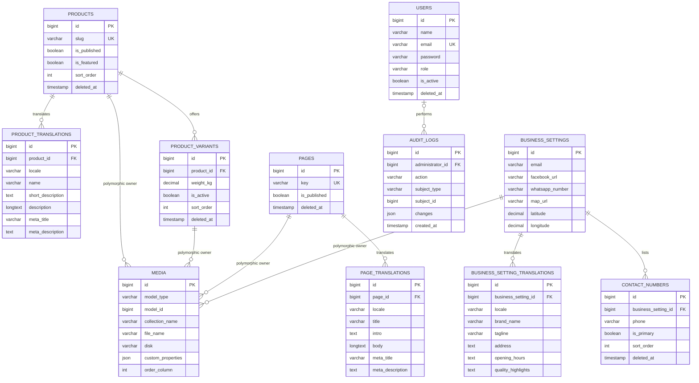

# Golden Spike Website Database ERD

This MySQL design supports the business website and product showcase defined in [the PRD](PRD.md). Products have pack variants; editable content has Arabic and English translations; Spatie Media Library owns media records. There are no sales or customer entities in the confirmed scope.

## Entity relationships

Each media row belongs to exactly one model identified by `(model_type, model_id)`. The four ownership edges show possible owner types, not four simultaneous foreign keys. Audit subjects also use a polymorphic reference; deleted subjects remain identifiable in the audit history.

## Tables and business rules

| Table | Purpose and rules |
| --- | --- |
| `products` | One entry per distinct rice product. Stable shared slug across locales for existing API clients. Website details use the product ID, such as `/ar/products/details?id=2`. Publishing requires both translations and at least one active variant. |
| `product_translations` | Unique `(product_id, locale)`. Required name, short description, and description for each supported locale; SEO fields optional. |
| `product_variants` | Pack sizes, stored as `DECIMAL(8,3)` kilograms. Require positive weight and unique `(product_id, weight_kg)`. No SKU, price, or stock fields are needed for this showcase. |
| `pages` | Fixed keys `home`, `about`, and `contact`. Manage content through dedicated Filament forms rather than a general page builder. Publishing requires both translations. |
| `page_translations` | Unique `(page_id, locale)`. Home title and intro supply the hero; About uses the body; Contact can have a short introduction. Sanitize rich text before rendering. |
| `business_settings` | One permanent settings record for the business, enforced by the application. Email and Facebook URL required for launch; WhatsApp and coordinates optional until verified. No soft deletion. |
| `business_setting_translations` | Unique `(business_setting_id, locale)`. Brand name, tagline, address, opening-hours text, and quality highlights are translated content. Highlights use plain text, one item per line. |
| `contact_numbers` | E.164 phone strings, not numeric columns. Unique `(business_setting_id, phone)`. Enforce exactly one primary active number in a transaction. |
| `users` | Filament administrators only. Roles `admin` and `editor`, enforced through policies. Store hashed passwords and standard Laravel authentication fields. Deactivated or deleted accounts cannot access Filament. |
| `audit_logs` | Append-only records of sensitive changes with actor, action, subject, timestamp, and a limited change summary. Actor can become null if permanently deleted; preserve actor identity in the change summary when needed. Exclude secrets. |
| `media` | Use the complete migration shipped with the installed Spatie version; the diagram lists only key fields. Do not create separate product-image tables or duplicate file paths on domain records. |

All domain parent tables except `audit_logs` include `created_at` and `updated_at`. Translation tables do not need timestamps. `audit_logs` uses `created_at` only. Framework infrastructure tables for sessions, queues, failed jobs, and cache are omitted from the diagram and added when required by configured drivers.

## Translation implementation

Use an Astrotomic translation model for each translated parent: `ProductTranslation`, `PageTranslation`, and `BusinessSettingTranslation`. Configure supported locales as `ar` and `en`. Keep translatable attributes in the separate translation tables; shared fields such as weight and contact numbers stay on parent or related records. This follows [Astrotomic’s translation-table convention](https://docs.astrotomic.info/laravel-translatable/installation).

Enforce unique parent/locale pairs and foreign keys. Hard deletion cascades to translation rows; soft deletion preserves them. Restrict locales to `ar|en` in validation and database constraints. Public resources return the requested translation only. Publication validation ensures required content exists in both languages, including after edits to published records.

## Media ownership and collections

| Owner | Collection | Cardinality and purpose |
| --- | --- | --- |
| Product | `cover`, `gallery` | One cover and multiple detail images. |
| ProductVariant | `packaging` | One image for a specific pack weight. |
| Page | `hero`, `gallery` | One hero and optional story images. |
| BusinessSetting | `logo` | One approved brand logo. |

The polymorphic owner, collection, storage, and metadata fields follow [Spatie’s media migration](https://github.com/spatie/laravel-medialibrary/blob/main/database/migrations/create_media_table.php.stub). Use `custom_properties` for localized alt text such as `alt.ar` and `alt.en`, and an optional `locale` for language-specific artwork. Require appropriate alternatives for meaningful images; decorative images use empty alternatives.

Configure thumbnail and responsive conversions, queue processing, and validate MIME types and file size. Soft deletion keeps attached assets recoverable; explicit force deletion removes owned media through the package lifecycle. Restrict and audit direct media removal because removing a file is irreversible without a backup.

## Integrity and indexing

- Use unsigned bigint primary and foreign keys and `utf8mb4` for Arabic.
- Index product publication, featured status, and ordering according to actual queries; index variants by product, active status, and ordering.
- Index audit actor and creation time, and `(subject_type, subject_id)`. Retain audit entries independently of subject deletion.
- Slugs and pack weights remain reserved after soft deletion; restore the existing record instead of creating duplicates.
- Public queries exclude deleted parents, inactive variants, and unpublished content. A deleted product hides all variants without deleting their records.
- Restrict hard product deletion while variants exist; the explicit force-delete Action removes dependent variant media and variants, then product media and the product, and records the audit event. Translation foreign keys cascade.
- Fixed pages must be restored rather than duplicated. Block settings deletion and public exposure of private administrator or audit data.
- Seed one settings record and fixed page keys. Treat the observed 1, 5, 10, and 25 kg weights as draft catalog content pending confirmation, not confirmed sellable inventory.

## Example catalog

If the owner confirms the packs share the same rice type, create one product, “Premium Egyptian Rice,” with Arabic and English translations and four weight variants. If packs represent genuinely different rice grades, create separate products for those grades and assign their actual sizes. Packaging color alone is insufficient to establish a separate product.
